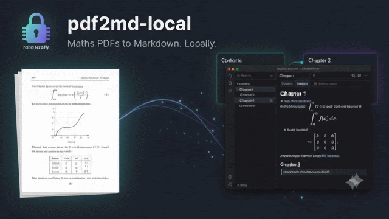

# pdf2md-local



Convert maths and science PDFs to Markdown **on your own machine**: LaTeX equations, figures, tables, headings, and
whole books split into linked chapter notes. Use it as a **command-line tool** (plain Markdown, works anywhere) or as an
**Obsidian plugin**. Documents are never uploaded.

## Features

- Inline/display LaTeX (`$…$`, `$$…$$`), figures and tables.
- **Chapter splitting** with a contents index and Previous / Contents / Next links.
- PDF bookmarks guide heading hierarchy; optional page links connect notes to the source PDF.
- Source-backed checks retry damaged equations or keep an exact source image instead of guessing.
- Batch conversion, page ranges, checkpoint/resume and progress with ETA.
- Two output flavours: `plain` (standard Markdown links and images) and `obsidian` (wikilinks and `![[embeds]]`).
- Clean notes: the internal per-page comments are removed after heading repair (`--page-markers` keeps them).
- Only new files are written; existing notes and source PDFs are never overwritten.

**Model:** PaddleOCR-VL-1.6 served by llama.cpp, with the recommended **2.5 Balanced** page resolution. The tested
setup used about **3 GB VRAM** on a **16 GB GPU**; an 8 GB card is expected to fit but is untested.

## Install

You need [uv](https://docs.astral.sh/uv/), a GPU (NVIDIA recommended) and about 2 GB of disk for the model plus a few
GB for Python packages and the llama.cpp download. Details, other platforms and troubleshooting:
[docs/install.md](docs/install.md).

```bash
uv tool install git+https://github.com/jyothisable/pdf2md-local   # the pdf2md command
pdf2md setup       # once: worker environment, model, and a prebuilt llama.cpp (llama-server) if you have none
pdf2md selftest    # converts a bundled 2-page sample and checks the result
```

`pdf2md setup` is the only step that downloads anything. It picks the llama.cpp build for your system (CUDA, Vulkan,
Metal or CPU) from the official releases and verifies its checksum; `--llama skip` leaves llama.cpp alone.
`pdf2md check` shows what is ready at any time, and `pdf2md info book.pdf` estimates the time before you convert.

## Use

```bash
pdf2md serve                                   # terminal 1: start the model server (leave running)
pdf2md book.pdf --split-chapters               # terminal 2: convert (-o out/, --pages 60-79, --flavor plain|obsidian)
pdf2md a.pdf b.pdf -o out/                     # batch
pdf2md --help
```

Or let the tool start and stop the server for you: `pdf2md book.pdf --serve-command "pdf2md serve"`.

Outside an Obsidian vault the output is `plain` Markdown; inside a vault (a folder containing `.obsidian`) it is
`obsidian` unless you pass `--flavor`. In a vault, a backup command of your choice can run first
(`PDF2MD_BACKUP_COMMAND` or `--backup-command`); nothing is run by default.

The `PROGRESS <done> <total>` lines on standard output are a stable, machine-readable progress feed.
`pdf2md check --json` and `pdf2md info --json` print the readiness report and time estimate that the plugin uses.

## Obsidian plugin

Desktop only. After installing and checking the command-line tool as above:

1. Install **PDF to Markdown (pdf2md-local)** from **Settings → Community plugins** once it is listed, or for now
   copy `main.js`, `manifest.json` and `styles.css` from the [latest release](../../releases/latest) to
   `<vault>/.obsidian/plugins/pdf2md-local/` (or use [BRAT](https://github.com/TfTHacker/obsidian42-brat)).
2. In the plugin settings press **Check**; anything missing is listed with a command you can copy.
3. Right-click a PDF or folder → **Convert to Markdown**, or use the command palette (page ranges, several PDFs, cancel).
   Before a long conversion the plugin shows the page count and estimated time and asks you to confirm.

The progress window shows pages, stage and ETA; **Run in background** keeps the conversion running and the status bar
reopens it.

**What the plugin does and does not do**

- It runs the `pdf2md` program you installed (and, only if nothing is listening, `pdf2md serve` or your own start
  command) as a local process, and stops it afterwards. It **never installs, downloads or updates anything itself**.
- It reads the selected PDFs from your vault and writes new notes and images into your vault (or the output folder you set).
- No telemetry, ads or accounts. The only network traffic is to the model server address you configure
  (default `127.0.0.1`); `pdf2md setup` downloads packages and the model once, when you run it in a terminal.
- **Files outside the vault:** the `pdf2md` tool keeps its worker environment in `~/.local/share/pdf2md-local`,
  model files in `~/.cache/pdf2md/models`, and temporary checkpoints in `~/.cache/pdf2md` (removed after a successful
  run), and writes the model server log to your system temp folder. It reads and writes nothing else outside the vault.
- Settings are stored in the plugin's `data.json`; no secrets are involved.

## Current benchmark

**PaddleOCR-VL-1.6, source guards enabled, scale 2.5 Balanced (180 dpi).** Measured on 46 single-page PDFs from a
seeded [olmOCR-bench](https://huggingface.co/datasets/allenai/olmOCR-bench) development subset, with 279 checks
across eight categories and the official scorer.

| Category | Passed | Score |
|---|---:|---:|
| arXiv maths | 52/57 | **91.2%** |
| Scanned maths | 35/57 | 61.4% |
| Tables | 19/25 | **76.0%** |
| Old scans | 12/31 | 38.7% |
| Headers and footers | 14/14 | **100.0%** |
| Multi-column | 18/21 | **85.7%** |
| Long/tiny text | 24/28 | 85.7% |
| Baseline checks | 45/46 | 97.8% |
| **Overall: mean across categories** | | **79.6% ±3.6 points (95% CI)** |

All 46 PDFs converted. Mean runtime: **6.48 seconds/PDF** on an RTX 5060 Ti (16 GB), including per-PDF startup.
This is a small, reused development set—not an independent accuracy test. Image fallbacks do not count as recognized
LaTeX. Only scale 2.5 with Paddle is covered. [Exact results and code hashes](bench/results/source_guarded25_20261120.json).

### Book extraction validation

**Two complete mathematical/deep-learning books**, scale 2.5:

| Metric | Result |
|---|---:|
| Source pages represented | **1,093** |
| Notes, including both contents indexes | **44** |
| Image assets | **946** |
| Combined conversion time | **61 minutes** |
| Missing image targets / broken navigation links | **0 / 0** |
| Math-structure warnings | **0** |
| Formulas preserved as source images | **110** |

Chapter splitting, navigation and page coverage were checked. A 33-page sample was also compared with the PDFs.
This was not a full factual proofread; code extraction was not validated.

## Limitations

- OCR and heading errors can remain even with zero structural warnings. Check important equations against the PDF.
- Source-image fallbacks are **not editable LaTeX**. Merged-cell tables stay as HTML.
- Old scans and complex layouts remain difficult.
- Tested on Linux with a 16 GB GPU; 8 GB GPUs, macOS and Windows are untested.

## Development

```bash
npm install
npm test               # plugin unit tests + contract test against the CLI's real --help
npm run test:py        # Python tests (no models needed)
npm run build          # type-check and bundle main.js
```

Layout: `pdf2md_local/` (Python package), `src/` (plugin), `tests/`, `bench/` (benchmark harness), `docs/`.
See [CONTRIBUTING.md](CONTRIBUTING.md) and the [changelog](CHANGELOG.md).

## License

[MIT](LICENSE). PaddleOCR-VL and llama.cpp are open source (Apache-2.0 and MIT); other models you use have their own licences.
