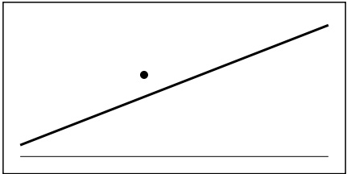

[Previous](01%20Calculus%20essentials.md) | [Contents](00%20Index.md)

# 2 Linear algebra

## 2.1 Matrices

A matrix with entries $a_{ij}$ acts on a vector v:

 

$$
\left|\boldsymbol{A}\boldsymbol{v}=\begin{pmatrix}a&b\\ c&d\end{pmatrix}\begin{pmatrix}x\\ y\end{pmatrix}=\begin{pmatrix}ax+by\\ cx+dy\end{pmatrix}\right|.
$$

 

The determinant of a two by two matrix is $\det A = ad - bc$.

## 2.2 A figure

Figure 1. A line crossing an axis.
